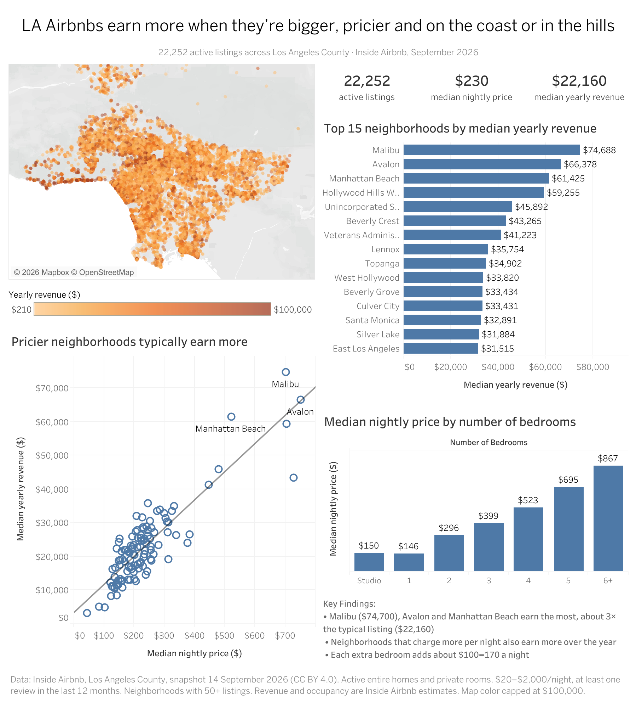

# What makes an LA Airbnb earn more?



**[Open the interactive dashboard](https://public.tableau.com/app/profile/alexander.wu1060/viz/LAAirbnbsearnmorewhentheyrebiggerpricierandonthecoastorinthehills/Dashboard2)**

## Question

Which Airbnb listings in Los Angeles County earn the most? What variables do they have in common: location, nightly price, size, or the host?

## Key findings

- **Price and revenue rise together.** Across 111 neighborhoods with 50+ listings, neighborhoods with higher nightly prices almost always earn more per year, with mild exceptions (Beverly Hills: 14th by price, 65th by revenue).
- **Location could be the real-world explanation.** The top-earning neighborhoods are coastal or hillside: Malibu ($74,688 median yearly revenue), Avalon ($66,378), and Manhattan Beach ($61,425), about 3× the county median of $22,160.
- **Size drives price.** Studios and 1-bedrooms charge about the same ($150, $146 a night); a 2-bedroom charges about twice that ($296); each extra bedroom adds roughly $100–170.
- **Superhosts earn 2.3× more** ($31,021 vs $13,467 median), with the largest gap among listings rated above 4.8 stars ($33,660 vs $11,899).
- **The City of LA is mostly monthly rentals:** 74.8% of its listings require 30+ nights, against 22.8% in other cities and 10.3% in unincorporated areas.

## Data

[Inside Airbnb](https://insideairbnb.com/get-the-data/), Los Angeles, snapshot of 14 September 2026: `listings.csv.gz` (43,781 listings, 79 columns) and `neighbourhoods.csv`. The raw files aren't included in this repo. See [data/README.md](data/README.md) for details and known data issues.

## Methods

**1. Load.** The raw CSV was loaded into PostgreSQL as text using DuckDB, so no row could fail on a bad value (`sql/00_load.sql`).

**2. Clean** (`sql/01_helpers.sql`, `sql/02_clean.sql`). Text was converted to real types with helper functions that turn invalid values into NULL instead of failing: prices like `"$1,250.00"` to numbers, `t`/`f` flags to booleans, dates
to dates.

**3. Define the listings to analyse** (`sql/03_active.sql`):

| Step | Listings |
| --- | ---: |
| All listings | 43,781 |
| With a price | 36,687 |
| Price between $20 and $2,000 a night | 36,059 |
| Entire homes and private rooms only | 35,402 |
| At least one review in the last 12 months | 22,252 |

**4. Analyse** (`sql/10_analysis.sql`). Used medians rather than averages, because a few very expensive listings could pull averages up. Neighborhood rankings include only neighborhoods with 50+ active listings.

**5. Visualise** (`sql/20_export.sql`, Tableau Public). Two views were exported to CSV, one row per listing and one per neighborhood, and built into the dashboard.

## Limitations

- Revenue and nights booked are Inside Airbnb estimates, not real booking records.
- One snapshot; prices and bookings vary by season.
- Findings are associations, not causes. For example, Superhost status partly reflects bookings rather than causing them.
- Host response rate and acceptance rate are empty in this snapshot, so host responsiveness could not be analysed.
- `host_listings` counts all of a host's LA listings, including those outside the active set.

## Repository

```
data/README.md        source, snapshot, known data issues
sql/00_load.sql       load the raw CSV into PostgreSQL
sql/01_helpers.sql    safe text-to-number and text-to-date functions
sql/02_clean.sql      typed, renamed listings table
sql/03_active.sql     the active-listings view used for analysis
sql/10_analysis.sql   analysis questions, each with its result
sql/20_export.sql     views exported for Tableau
sql/explore.sql       exploration and data checks
exports/              the two CSVs behind the dashboard
images/dashboard.png  png of dashboard
memo.md               one-page summary for homeowners
```

## How to reproduce

Download `listings.csv.gz` and `neighbourhoods.csv` (Los Angeles) from Inside Airbnb into `data/raw/`, then run `createdb airbnb`, `duckdb < sql/00_load.sql`, and the remaining files in `sql/` in number order with `psql airbnb -f`.

**Tools used:** PostgreSQL (cleaning and analysis), DuckDB (loading the raw file), Tableau Public (dashboard).